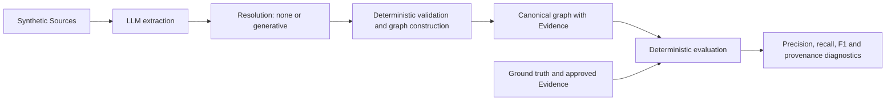

# Private Client Graph

Private Client Graph explores whether an LLM can reconstruct **family and trust
relationship graphs** from synthetic private-client documents, preserving exact
source evidence and measuring the result against known ground truth.

An FTEC5660 MSc AI research prototype, it combines a benchmark pipeline, a local
Research Workbench, and a practitioner application for reviewing synthetic Matters.
**Use synthetic or fictional material only. Never submit real client or personal
information.**

## Start locally

Docker is the only prerequisite for either application. Run commands from the
repository root.

### Research Workbench

Configure experiments, freeze independent Runs, and inspect relationship quality,
source evidence, and available provider costs:

```bash
docker compose up --build -d
```

Open [http://127.0.0.1:8080](http://127.0.0.1:8080). Use the deterministic
demonstration to explore without credentials. Paid execution is disabled by
default and requires explicit authorization for each Run.

Stop with `docker compose down`. Keep `runs/research` and its task ledgers together;
they hold authoritative artifacts and execution accounting. PostgreSQL is a
rebuildable research index. See the [Research Workbench guide](research/README.md)
for the current workflow and recovery details.

### Practitioner application

Upload synthetic PDFs, inspect proposed relationships and their evidence, then
confirm the whole graph to create a Matter:

```bash
docker compose --profile practitioner up --build application
```

Open [https://localhost:8443/app](https://localhost:8443/app) and accept the warning
for the temporary development certificate. The local environment substitutes
Google identity and model responses, so no external credentials are needed.
Authentication, PDF validation, graph construction, and PostgreSQL persistence
remain real.

For a deterministic walkthrough, use `tests/fixtures/synthetic-proposal.pdf` and
`tests/fixtures/multiple-role-proposal.pdf`. These demonstrate the review workflow;
the local model substitute does not measure extraction quality on arbitrary PDFs.

Stop with `docker compose --profile practitioner down`. Database state survives
ordinary restarts; adding `-v` deletes Compose database volumes. See the
[application setup and deployment guide](docs/workflows/application-setup.md)
for lower-level development, authentication, database setup, and Railway deployment.

Existing deployments upgrading from legacy canonical storage must follow the
[coordinated cutover and recovery procedure](docs/workflows/canonical-matter-cutover.md).

## How it works



The Shared Analysis Pipeline has a fixed **Extract → Resolve → Construct Graph**
topology. Research can select no resolution or generative alias resolution;
application analysis uses the approved no-resolution configuration. The LLM
interprets language. Code validates references and exact quotations, constructs
entities and relationships, assigns IDs, canonicalises output, and scores results.
Evaluation remains separate from practitioner review.

Canonical graphs contain entities, relationships, and first-class Evidence.
Every relationship must have source evidence. Accepted Matters and pending Matter
Proposals persist separate relational facts in PostgreSQL; their graph
representations are reconstructed deterministically. Research artifacts and task
ledgers remain authoritative on disk.

## Scope

| Area | Supported |
| --- | --- |
| Entities | `person`, `trust` |
| Family relationships | `parent_of`, `sibling_of`, `spouse_of` |
| Trust relationships | `settlor_of`, `trustee_of`, `beneficiary_of` |
| Provenance | Exact quotations attributed to their Sources |
| Research | Frozen inputs and settings, saved or fresh extraction, configurable resolution, deterministic evaluation |
| Practitioner workflow | Synthetic PDF intake, proposal review, whole-graph confirmation, persisted Matters |

The benchmark includes explicit relationships, aliases, multiple Sources, and
trustee replacement. See the [authored cases](cases/README.md) and
[held-out evaluation cases](evaluation_cases/README.md) for the individual
hypotheses and limitations. This is an experimental prototype; benchmark results
do not establish production reliability.

## Python development

Requires Python 3.11+ and [uv](https://docs.astral.sh/uv/).

```bash
uv sync --locked
uv run pytest
```

Tests are deterministic and require no live provider calls. PostgreSQL integration
tests require `TEST_DATABASE_URL`; without it they report explicit skips. See the
[database test setup](docs/workflows/application-setup.md#postgresql-initialization-and-integration-tests)
and [web testing strategy](docs/WEB_APP_GUIDELINES.md) for full validation.

For a live Case 01 CLI extraction, set `DEEPSEEK_API_KEY` in a local `.env` file or
the environment, then run this within an authorized provider-call budget:

```bash
uv run python -m private_client_graph.extract
```

This invokes the paid provider. Successful extractions are saved under the
Git-ignored `runs/case_01/` directory. Evaluate a saved extraction offline:

```bash
uv run python -m private_client_graph.evaluate runs/case_01/<run>.json
```

## Evaluation

Relationship scoring compares semantic edges rather than generated IDs.
`spouse_of` and `sibling_of` are symmetric; other relationships retain direction.

| Metric | Meaning |
| --- | --- |
| TP / FP / FN | Correct, incorrectly predicted, and missed relationships |
| Precision | Fraction of predicted relationships that are correct |
| Recall | Fraction of expected relationships recovered |
| F1 | Balance of precision and recall |
| Provenance accuracy | Fraction of correct relationships with at least one approved exact evidence span |

Provenance is scored separately on true-positive relationships. Each ground-truth
edge has human-approved exact evidence spans; one matching attached span is enough
to pass. True negatives are not enumerated because the possible relationships that
do not exist form an open-ended set.

The public Research Results interface serves a packaged snapshot of retained
results. See the [publication workflow](docs/workflows/public-research-publication.md)
for provenance, reproduction, and interpretation limits.

## Repository layout

```text
private_client_graph/  Extraction, resolution, graph, evaluation, APIs, persistence
web/                   Public, practitioner, and research frontends
cases/                 Authored synthetic benchmark cases
evaluation_cases/      Held-out synthetic evaluation cases
research/              Research guides, retained history, and validation material
tests/                 Deterministic unit, integration, and fixture coverage
docs/                  Engineering guidance, domain decisions, and workflows
presentation/          Product demonstrations and presentation assets
runs/                  Local outputs, research artifacts, and ledgers (Git ignored)
```

## Project guidance

Benchmark cases start with ground truth, then add one difficulty at a time so
failures remain interpretable. Add architectural complexity when demonstrated
needs justify it. Keep semantic extraction, deterministic construction, evaluation,
application orchestration, and presentation separate.

- [Project glossary](GLOSSARY.md) and [architecture decisions](docs/adr/)
- [Agent instructions](AGENTS.md) and [code style](docs/CODE_STYLE.md)
- [Web application guidelines](docs/WEB_APP_GUIDELINES.md)
- [Synthetic case authoring](docs/workflows/synthetic-case-authoring.md)
- [Research Workbench](research/README.md) and [persistent Experiment and Run contract](docs/workflows/persistent-research-workspaces.md)
- [Legacy study operations](research/legacy-workbench.md) and [archive provenance](research/history/README.md)
- [Application setup and deployment](docs/workflows/application-setup.md)
