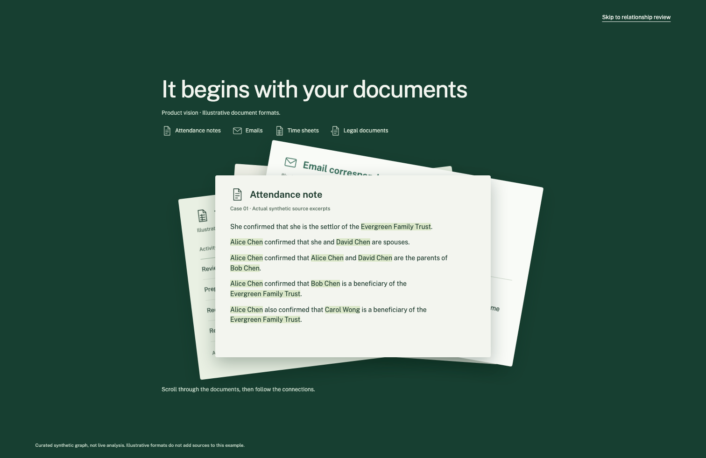
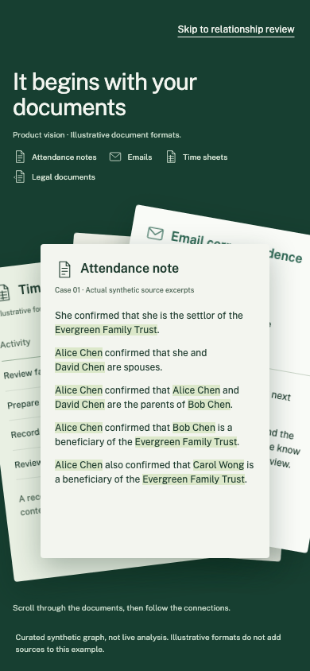

# Document paper flick refinement

The previous montage changed front sheet abruptly over a short scroll interval.
The revised papers lift, sweep across and settle with a small counter-movement.
One shared Motion spring gives the stack weight while keeping it reversible.
Paper opacity still follows raw scroll progress so skipping to review does not
wait for the spring. The graph, source anchors and reduced-motion alternative
retain their existing behavior.

## Review clips

Identical scripted scrolling through the first 36% of the story on the combined
application, with self-hosted fonts loaded:

- [Desktop before](desktop-before.webm) — main at `d5130917`.
- [Desktop after](desktop-after.webm) — 1512 × 982.
- [Phone after](phone-after.webm) — 390 × 844.

The clips use a fixed scroll cadence for comparison. In the product the reader
controls the speed and can stop or reverse anywhere.

The first visual review found lifted corners intruding into the format labels.
The final pass reduced lift and rotation and reserved clearance in animated
layouts. The confirmation review checked desktop and phone screenshots.

## Validation

- Production build and TypeScript: passed.
- Frontend unit tests: 165 passed across 36 files.
- Full Python suite: 739 passed.
- Landing browser suite on native Chromium: 22 passed, 6 viewport-specific skips.
- Same landing suite in Linux Playwright Chromium: 22 passed, 6 viewport-specific skips.
- New browser coverage checks visible lift before front-order change, format-label
  clearance, settling, reverse scrolling and immediate skip to evidence review.
  Existing coverage checks source-name origins, graph drawing, evidence selection,
  reduced motion, compact layouts, localization and backend reads.
- Scoped Impeccable detector: no findings.
- Application provider calls: 0 of the task allowance of 5.

The checks use the real curated synthetic read API. No backend or domain changes,
new dependencies, live provider calls or persisted Matter mutations are involved.

Motion references consulted before implementation:
[scroll-linked spring example](https://examples.motion.dev/react/scroll-linked-with-spring)
and [useSpring documentation](https://motion.dev/docs/react-use-spring).
