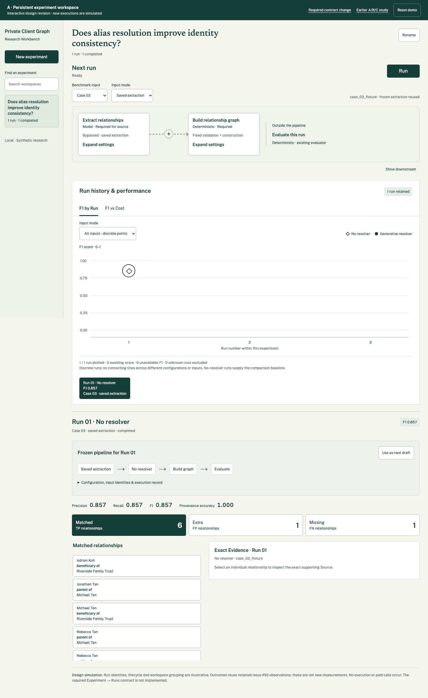
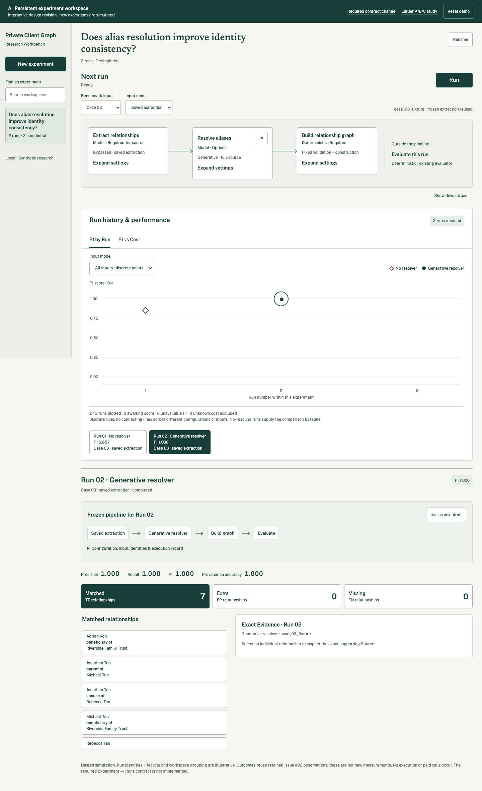

# Research Workbench: approved persistent Experiment workspace

Status: revised direction A approved by the user on 2026-10-12, including the final connector geometry and simplified Run copy. This records design approval; production implementation is a separate task.

## Approved interaction

An Experiment is a named persistent research workspace containing many independently configured, immutable Runs. The pipeline editor configures the next Run. Editing it preserves every previous Run and keeps the researcher in the same Experiment.

The primary **Run** button sits beside the pipeline editor. It is available for a valid executable draft, including a changed configuration or a repeated unchanged configuration. It opens review. Freeze, authorization where required, and start remain explicit controls in that flow. The permanent lifecycle caption and button ellipsis are removed; necessary guidance appears at the relevant step.

Once at least one observation is scored, one aggregate point represents the Run on the same Experiment’s performance chart; incomplete coverage is visibly provisional. Selecting a point opens that Run’s frozen configuration, input identities, provenance, cost, TP/FP/FN evaluation and exact Evidence below. Selection leaves the next-run draft intact. “Use as next draft” explicitly copies configuration without transferring execution authority.

Saved extraction and fresh extraction are input choices for a Run. They retain distinct comparison identities and cost coverage. The chart offers F1 by Run and F1 versus cost, with discrete points and honest exclusion of unavailable values.

## Naming and navigation refinement

User-directed addition, 2026-10-12. New Experiments require a human-readable name and offer an optional hypothesis/description. Names remain separate from stable IDs. Case names and descriptions come from manually authored repository-owned case JSON metadata; diagnostic fixture scenario labels remain distinct from their parent Case. The [metadata contract](research-workbench-experiment-run-contract.md#human-readable-metadata-contract) specifies artifact authority, frozen provenance, API coverage and legacy compatibility.

| Surface | Presentation |
| --- | --- |
| Experiment sidebar and history | Experiment name first, stable ID available as secondary detail; optional hypothesis/description in expanded details. Show explicit fallback names for legacy artifacts. |
| Case picker | Current authored Case name and description with stable Case ID; label any diagnostic fixture separately with its own scenario description. |
| Performance-chart tooltips | Experiment name, Run identity and frozen Case/fixture labels; make associated descriptions available in the same keyboard-accessible inspection content. |
| Run details | Experiment name and optional hypothesis/description, frozen Case/fixture names and descriptions, and separate stable IDs alongside existing provenance. |

The experiment sidebar must be manually collapsible on wide screens. Provide an always-reachable, labelled expand/collapse button with `aria-expanded` and `aria-controls`; collapsing it gives space back to the workbench without changing the selected Experiment, draft or Run. Keep the selected Experiment name visible in the workspace heading when the sidebar is hidden.

At the existing narrow-screen navigation breakpoint (below 760px), automatically collapse the sidebar and use an explicitly opened drawer. Preserve the user's wide-screen collapse preference separately; narrow mode must not force the sidebar open when returning to a manually collapsed wide layout. Close the narrow drawer after selecting an Experiment or pressing Escape, restore focus to its trigger, and keep keyboard focus within the open modal drawer. No hover-only navigation controls. Test manual toggle, crossing the breakpoint, keyboard operation and unchanged draft/selection state at wide and narrow widths.

These additions extend the approved handoff. The archived prototype and screenshots show the previously approved baseline; they do not yet demonstrate all metadata fields or this sidebar refinement. Implementation must satisfy this section as well as the visual baseline.

## Visual source of truth

- [Approved interactive prototype](assets/research-workbench-approved-run-workspace.zip). Extract and serve the `performance-workbench` directory using a local static HTTP server; open `/workspace-runs/`. The archive’s earlier A/B/C exploration is historical; `/workspace-runs/` is the approved design.
- [Required future contract](research-workbench-experiment-run-contract.md), including lifecycle, immutable snapshots, migration and comparison limits.
- Review evidence and interaction checks are included in `workspace-runs/design-review.json` and `workspace-runs/review/` inside the archive.

[Approved narrow layout](assets/research-workbench-run-workspace-mobile.png).

Retain the incumbent PCG typography, paper surfaces, ledger green and exact Evidence emphasis. Preserve the production pipeline’s supported nodes, inline settings, horizontal navigation and accessible insertion controls. The final prototype corrects the oversized connector: thin centered line, small arrowhead and centered insertion circle. Its simplified rendering is visual guidance, not a replacement component architecture.

Keep the default workspace concise. Do not reinstate explanatory model prose, redundant chart subtitles or the lifecycle caption alongside Run. Preserve actionable validation, authorization, coverage and error guidance. Prototype simulation labels distinguish illustrative data from real execution; they are not production interface copy.

## Implementation boundary

The current study-specific backend freezes an experiment plan and does not support adding independently configured Runs to a completed Experiment. Implementing this design requires the separately reviewed contract change above. Do not force users to create a new Experiment each time configuration changes, and do not imply the new model already exists in production.

Design approval does not authorize that backend change, production React work, paid executions or changes to extraction, identity, evaluation or provenance semantics. Preserve existing task-wide accounting and plan-bound authority. The approved separate lifecycle controls must be reconciled explicitly with the current atomic authorization/start API during future contract work.

The prototype demonstrates one input and one observation per Run. The approved [Run aggregate evaluation contract](research-workbench-run-aggregate-evaluation.md) now specifies multi-case observation-weighted micro-F1, provisional coverage, scope comparisons and total estimated provider spend incurred by the Run. All available Benchmark Cases are selected by default; each eligible Run contributes one point. This written contract supersedes the prototype’s single-observation limitation. Retained Issue #92 outcomes support the illustrations; simulated executions and chronology are not new measurements. Earlier approved workspace documents remain historical references where superseded here.

## Verification and review

The final prototype was checked at 1440px and 390px for changed and repeated configurations, separate authorization/start, immutable historical snapshots, draft preservation, keyboard Evidence inspection, cost exclusions and reload persistence. The finish review found no material issues. The final connector and copy refinements were included in the repeated workflow checks before approval.

Code Quality Review: this handoff changes documentation and isolated design assets only. Final review found no production changes or material readability concerns. Backend tests are not applicable to this approval record.

## Tracking

[Implementation follow-up #115](https://github.com/alistairkung/private-client-graph/issues/115) tracks the metadata contract and collapsible-sidebar refinement, linked from #100, #104, #105 and the Case authoring roadmap #78. Implementation remains separate from this handoff update.
