# Research Workbench: complete design reference

This is the visual review companion to the [implementation handoff](research-workbench-approved-workspace.md).
It covers the entire workspace, not only Evaluation. All screenshots below were
captured from the self-contained prototype shipped in this PR. They show design
states, not a production application or newly executed experiments.

Comparison bench B and Connector rail A, including inline settings and the
always-visible insertion control, are included in the complete implementation
authorized by the user on 2026-10-12. These design artifacts do not authorize paid
experiments or hypothetical capabilities. The implementation preserves #111's
atomic Authorize and start/continue API rather than adding a separate authorized
but not started backend state.

## Whole workspace: draft

The pipeline is the primary workspace. A persistent sidebar anchors New experiment,
recent experiments, search and historical browsing. Configuration, execution and
evaluation share the same page and experiment identity.

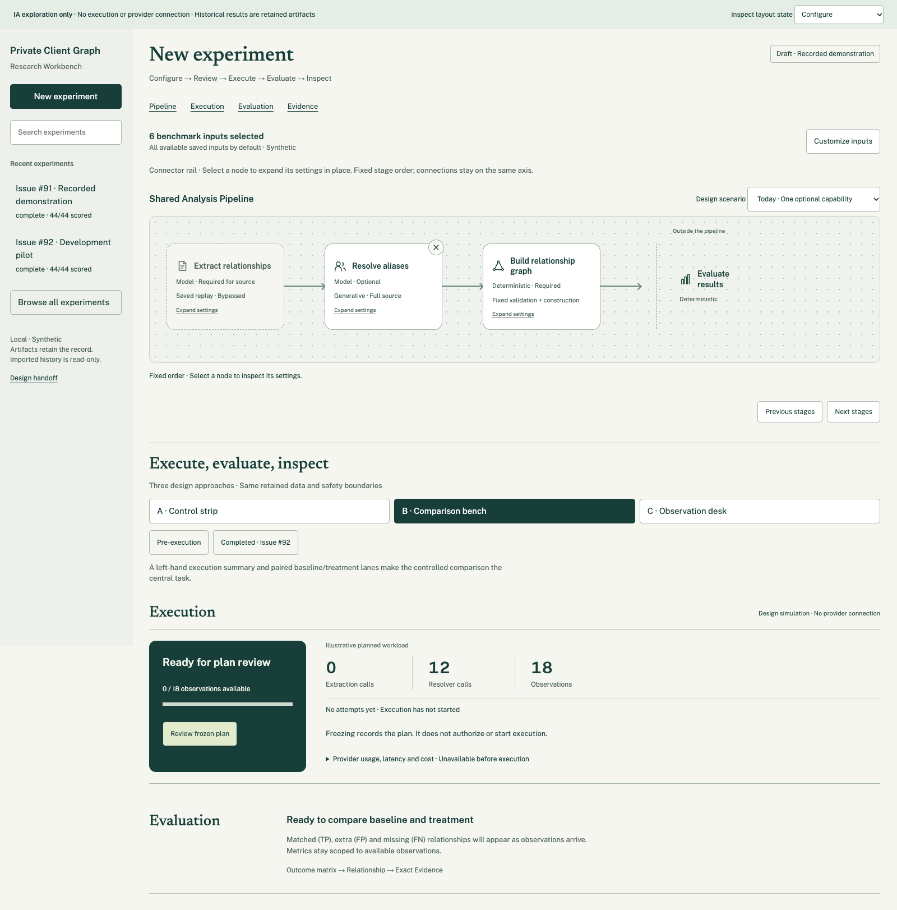

## Sidebar and historical navigation

New experiment is the primary action. Recent entries expose useful status and
coverage; the selected experiment is visually distinct. Search/browse opens the
chosen frozen artifact into the same workspace. Keep navigation usable while a
backend-owned run continues; changing the selected experiment must not stop or
restart it. The example history list is not the production pagination contract.


The complete historical view preserves the sidebar and pipeline while replacing
editable configuration with its frozen counterpart. Imported artifacts have no
execution controls. Retained results are inspectable immediately beneath them.

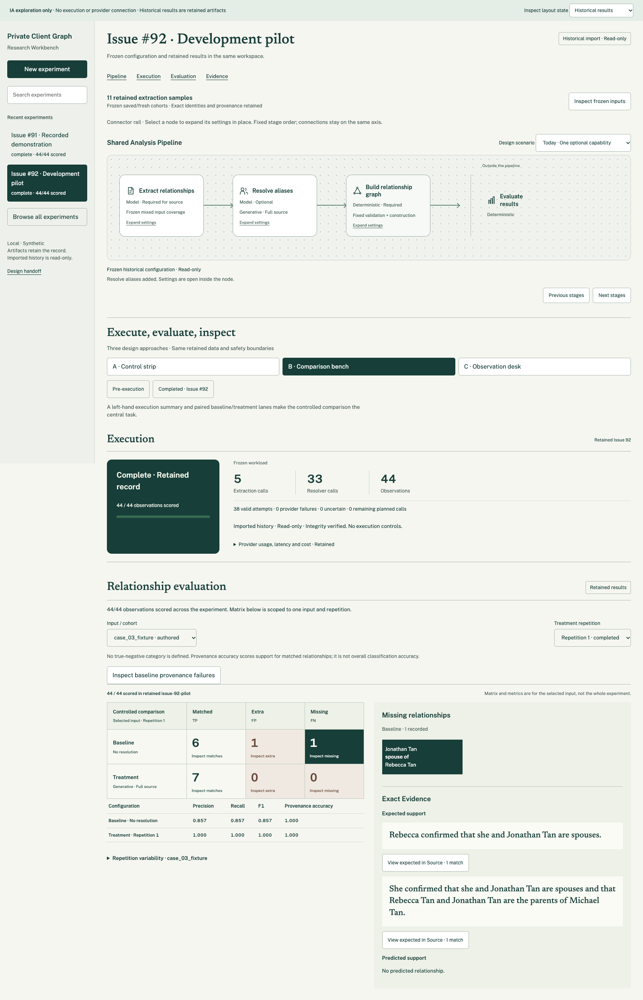

## Horizontal connector rail

Use the restrained green/cream palette and dot-grid canvas. Compact nodes show
name, operation type and configuration summary. Required extraction and graph
construction cannot be removed. Saved replay bypasses extraction; downstream
benchmark evaluation is visibly outside the Shared Analysis Pipeline.

Only alias resolution can be added at today's supported insertion point. There
are no drag handles, arbitrary ordering, branch editing or other executable
capabilities. The user-facing graph stage is “Build relationship graph”.

### Bypassed resolver: discoverable insertion

The absent resolver is a no-op path. An outlined circular + is always visible on
the eligible connector; it is not a hidden hover-only affordance. A persistent
text action supplies another non-hover entry point.

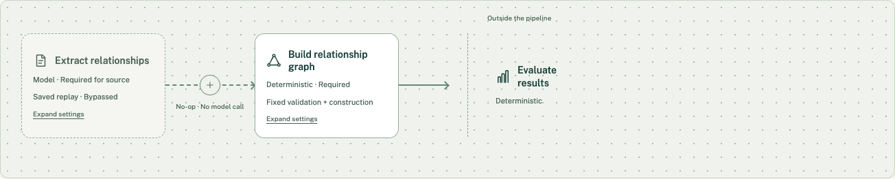

Hover or keyboard focus fills the circle dark green, makes the plus white, and
subtly scales the circle within its fixed target without moving the nodes. Focus
remains visible. Touch targets are at least 44px; reduced motion removes scaling.

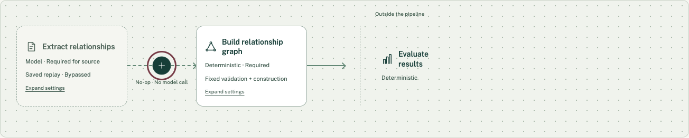

### Supported capability menu

The contextual menu offers only the supported resolver at that fixed position.
Escape/cancel dismisses it; keyboard selection inserts the node and moves focus
into its header. No hypothetical stage appears in the current-capability menu.

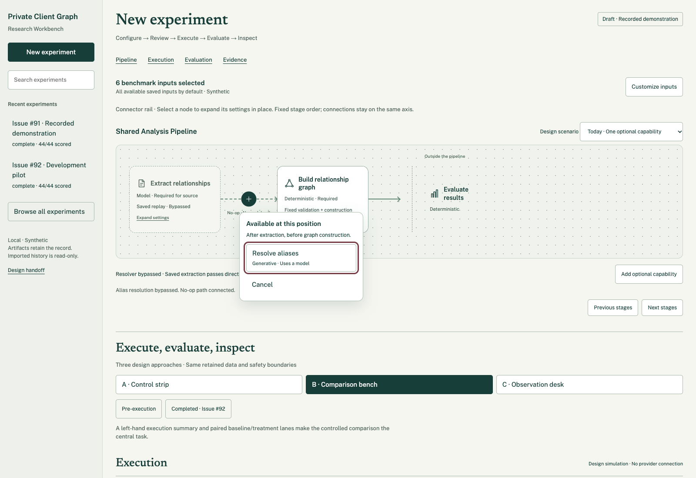

### Inserted resolver and removal

Inserting the resolver consumes that insertion point. Its + disappears and its
× becomes the bypass action. Removal selects no-op and reconnects neighboring
stages, returning focus to the eligible insertion control. It does not mutate
the backend topology or delete an arbitrary pipeline stage.

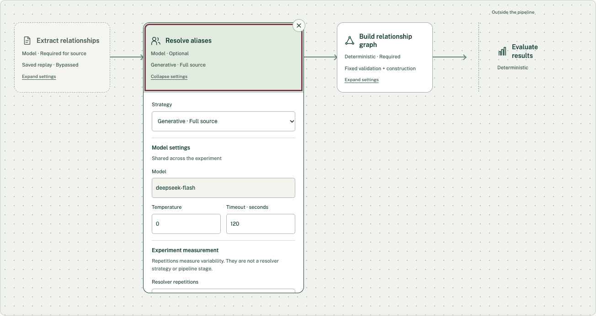

### Inline configuration

One node expands at a time. Settings remain inside it; the detached inspector
below the canvas is superseded. A stable header axis keeps connector alignment
while the selected node widens and neighbors move horizontally. Collapse retains
settings. Horizontal scrolling and explicit navigation preserve readable sizes.
Long settings stay within a bounded scrollable node body.

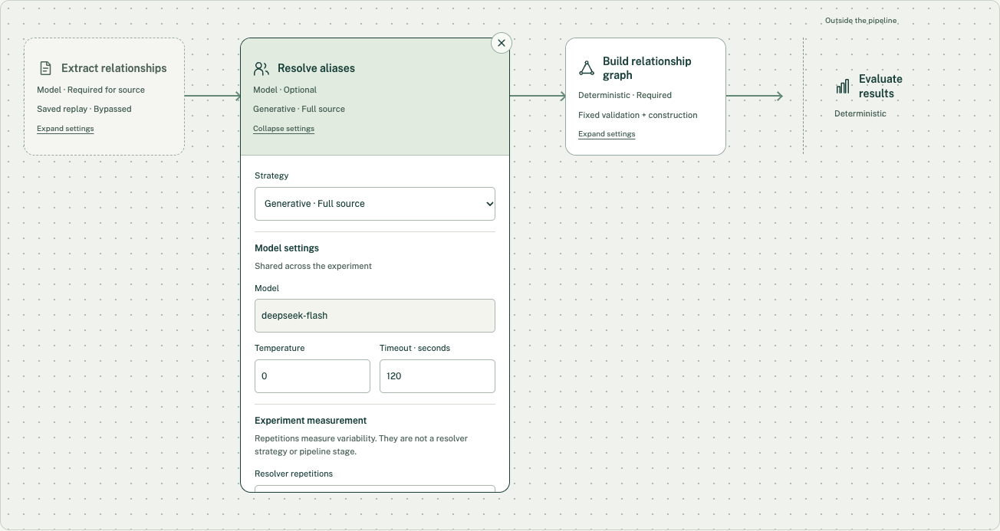

Only no-op and generative full-source resolution are supported. Shared provider
settings remain experiment-wide. Resolver repetitions belong to **experiment
measurement**, even though their contextual editor sits in the resolver node.
Do not copy mock numeric limits, models or configuration state into production
without binding to the actual supported API contracts.

## Compact benchmark input selection

All available inputs are selected initially. The workspace shows the count and a
Customize inputs action. The modal supports search, select all, clearing and
individual selection; applying an empty selection is unavailable. Historical
inputs are inspect-only and preserve exact sample/cohort identities.

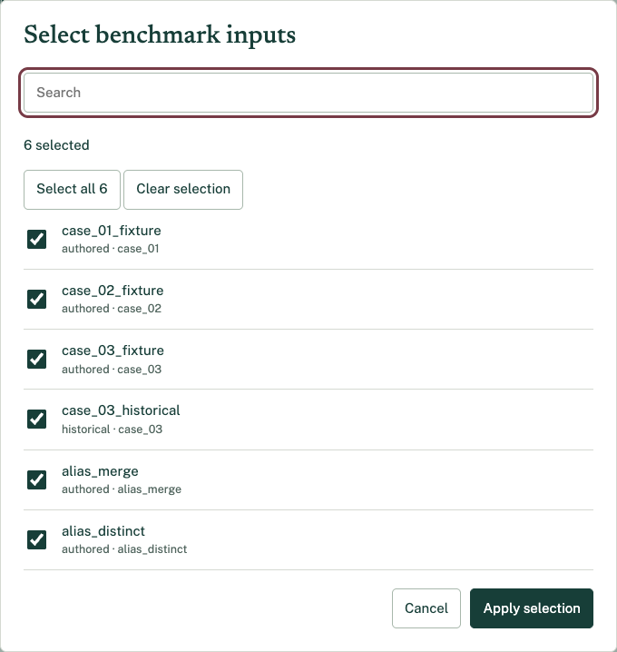

## Execution: approved Comparison bench B

The green status/control block anchors workload and accounting alongside it.
Draft preview, frozen review, authorization, authorized-not-started, running,
stop-requested, stopped, interrupted, failed and completed are distinct states.
The prototype demonstrates most of these through its scenario selector; the
implementation handoff additionally specifies server-confirmed stop acknowledgement.

Freezing does not authorize execution. Start and continuation use backend-owned
plan identity, allowance and authorization. Show provider usage, latency and cost
only where available, with coverage and pricing provenance. Distinguish attempts,
observations, uncertainty and unavailable telemetry. Refresh and navigation must
not lose or restart a run. The corrected Stop control has dark text on a light
surface and a contrasting focus ring.

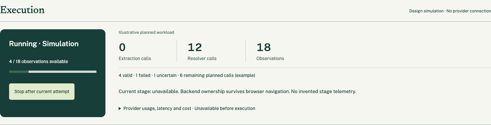

## Evaluation and exact Evidence: approved Comparison bench B

Keep baseline/treatment comparison on the left and relationship/Evidence inspection
on the right. The outcome matrix offers matched (TP), extra (FP) and missing (FN),
with no invented true negatives. Metrics and repetition variability retain input
and observation scope. Partial results carry explicit coverage and cannot appear
as final aggregates. Values come from retained evaluator outputs.

Selecting an outcome filters relationships; selecting a relationship reveals
expected and predicted support. Quote actions highlight exact retained occurrences
in frozen Source. A missing relationship has no predicted relationship to invent.

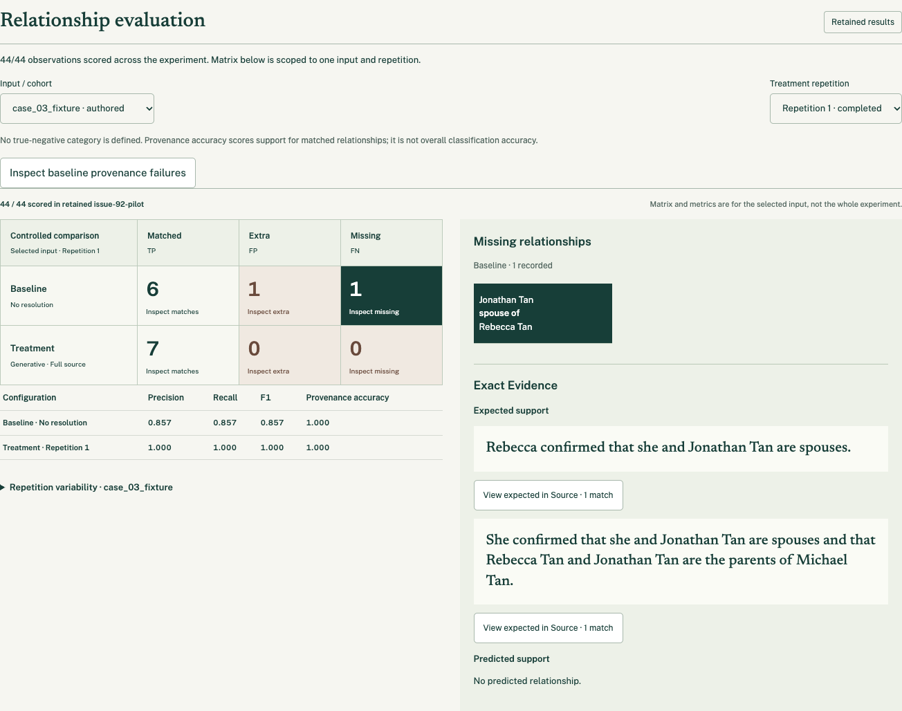

## Responsive behavior

On narrow screens the sidebar becomes a drawer. The pipeline remains horizontal,
with readable nodes and explicit navigation, rather than a vertical checklist.
The comparison and Evidence columns stack in reading order. Keyboard navigation,
visible focus, touch access and reduced motion apply to all these interactions.

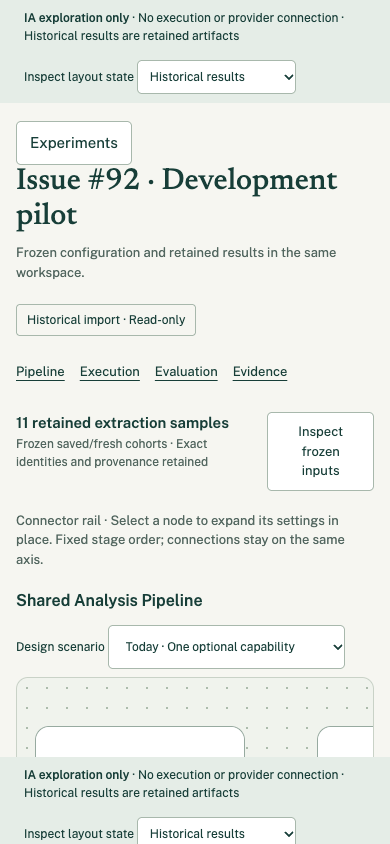

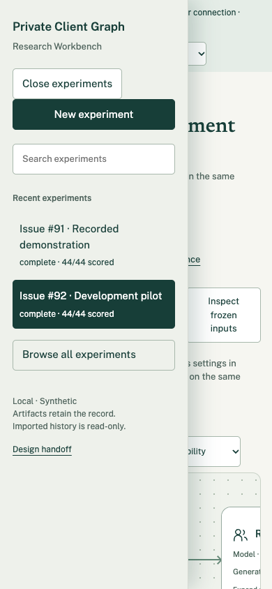

## Five-stage stress test — not production scope

The same rail is demonstrated with hypothetical support validation and role
classification. The scenario is explicitly labelled and separate from the real
draft configuration. Its stage placement, operation types and implementations are
illustrative, not approved backend capabilities. Preserve viewport navigation;
do not implement these nodes, arbitrary ordering or a generalized stage framework.

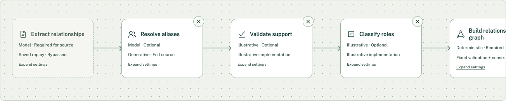

## Review the interactive archive

Download [the prototype archive](assets/research-workbench-approved-prototype.zip),
extract it into a temporary directory and serve that directory locally:

```bash
python3 -m http.server 59828 --bind 127.0.0.1 --directory /path/to/extracted-prototype
```

Open `http://127.0.0.1:59828/`. Comparison bench B is the default. Review:

1. Select, expand and collapse the resolver; inspect measurement settings.
2. Remove it; inspect default and focused + states; open its menu and reinsert.
3. Customize benchmark inputs; inspect sidebar history search and browse.
4. Follow frozen review → authorization → explicit start; stop and review continuation.
5. Open Completed · Issue #92; inspect baseline missing Case 03 → relationship → Source.
6. Compare repetitions; inspect partial/interrupted states without final aggregates.
7. Inspect the labelled five-stage stress test and narrow-screen drawer.

The prototype makes no provider calls. It contains retained synthetic research
data and simulated lifecycle controls. The implementation handoff owns acceptance
criteria, backend boundaries and required verification; this gallery supplies the
missing full-workspace visual reference.
